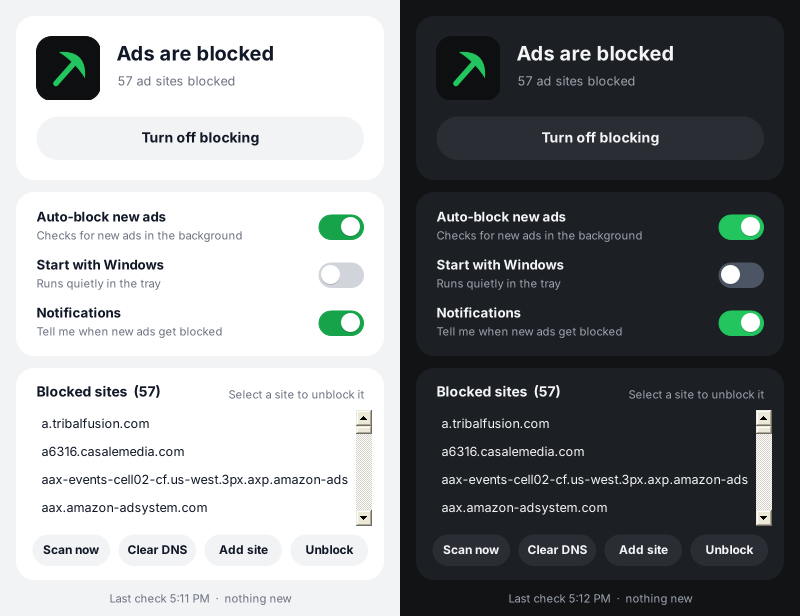

# Hardened source review copy

This modified source compiled successfully with .NET SDK 8.0.419 targeting .NET Framework 4.8. It has not been run or tested on Windows. It is not a malware-free certification. See SECURITY-REVIEW.md for findings and validation limits.

<p align="center">
  
</p>

<h1 align="center">PickAds</h1>

<p align="center">
  A small, free Windows app that blocks ads in Minecraft launchers like Lunar Client, Dawn Client and the Modrinth App.
</p>

<p align="center">
  
</p>

## Get the Windows build

After these files are pushed to GitHub, open **Actions**, select the latest successful **Build PickAds** run, and download **PickAds-Windows** under **Artifacts**. GitHub sign-in is required to download the ZIP. Extract the ZIP and scan the EXE with Defender before running it. Do not bypass a detection. GitHub building a file does not certify it as malware-free.

## Features

- **One click** to turn ad blocking on or off
- **Finds new ads automatically** in the background and blocks them
- **Start with Windows** is optional and off by default. Windows still asks for administrator permission at sign-in; no elevated scheduled task is created.
- **Unblock anything** with one click if a launcher stops working
- Light and dark mode, matching your Windows setting
- One small `.exe` (about 80 KB). Nothing to install. Uses the .NET Framework already built into Windows 10 and 11.

## How to use

1. Download and extract the build ZIP using the instructions above.
2. Open it and click **Yes** when Windows asks for permission. PickAds needs admin rights to edit the Windows hosts file.
3. Click **Turn on blocking** to edit the hosts file. Enable **Auto-block new ads** only if you want background DNS-cache inspection. Both are off by default for new settings.

If ads still show, fully close the launcher (check the tray near the clock) and open it again.

Keep antivirus protection enabled. Do not bypass a malware detection or restore the previously quarantined executable on the strength of this source review.

## How it works

PickAds adds ad-server domains to the Windows **hosts file** (`C:\Windows\System32\drivers\etc\hosts`), pointing them to `0.0.0.0` so your PC can't connect to them. It's the same idea as Pi-hole or a browser ad blocker.

- When automatic detection is enabled, every 15 seconds it checks the Windows DNS cache for recently visited domains and blocks any that match known ad networks.
- It **never modifies any launcher's files or the game**. It only blocks connections to ad servers.
- Its entries in the hosts file sit between `# >>> PickAds START` and `# <<< PickAds END`. Turning blocking off removes them and leaves the rest of your hosts file untouched.
- It doesn't collect or send any data. It never connects to the internet itself.

Settings and lists are stored in `C:\ProgramData\PickAds\`.

### Antivirus warnings

Some antivirus programs flag new, unsigned apps that edit the hosts file and start with Windows, because malware sometimes does those things too. A detection must be investigated; this source review cannot establish that an existing executable is safe or matches this source.

## Uninstall

1. Open PickAds and click **Turn off blocking**, remove any legacy PickAds scheduled task through Windows Task Scheduler after inspecting it. This version does not create or modify startup tasks.
2. Right-click the tray icon and choose **Exit**.
3. Delete `PickAds.exe` and the folder `C:\ProgramData\PickAds`.

## Build it yourself

**Easiest (no installs):** on Windows, double-click `build.bat`. The app appears in `dist\PickAds.exe`.

**With the .NET SDK:**

```
dotnet build PickAds.csproj -c Release -o dist
```

## Forks

Forks are welcome under the MIT License. Please **use a different name and icon** for your fork, so people don't confuse it with the official PickAds.

## Disclaimer

PickAds is an independent project. It is **not affiliated with, endorsed by, or connected to** Lunar Client (Moonsworth), Dawn Client, Modrinth, Mojang or Microsoft. All product names belong to their owners.

Blocking ads means launchers and creators earn less from you. On Modrinth, part of the ad revenue goes to mod creators. If you'd like to support them, consider [Modrinth+](https://modrinth.com/plus).

## License

[MIT](LICENSE)

## Optional startup

Move PickAds.exe to a permanent folder, open it, and turn on **Start with Windows**. Confirm the prompt. PickAds starts in the tray when your Windows user signs in and asks for administrator permission. Choosing No leaves it closed. Turn the switch off to remove its startup entry. Windows Settings > Apps > Startup can also disable it. Moving the EXE requires turning the switch off before moving, then on at its new location. This uses the current user registry Run key (PickAdsReviewed); it does not create, migrate, or refresh any scheduled task. Existing legacy tasks must be inspected separately. When using a different administrator account to approve UAC, settings belong to that administrator account.
