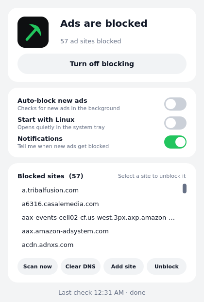
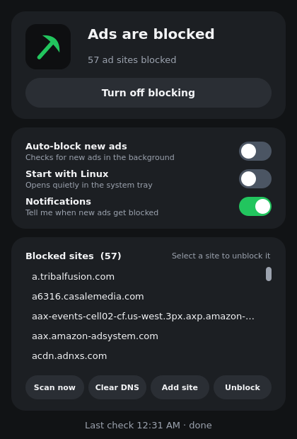

# PickAds for Linux — experimental

A Qt6 port of miniuid's Windows PickAds, aimed at Fedora 44 KDE Plasma.
The compact three-card interface, light/dark appearance, green switches,
blocklist, starter domains, scan, unblock, notifications and tray behavior
follow the Windows application. No launcher files are patched.




## Install on Fedora KDE

Download the `pickads-0.1.0-1*.noarch.rpm` package (not the `.src.rpm`).
In its folder, open a terminal and run:

```sh
sudo dnf install ./pickads-0.1.0-1*.noarch.rpm
```

Then open **PickAds** from KDE's application menu. Use KDE Discover's RPM
installer instead if your system offers it. Do not run the interface with sudo.
It depends on Fedora's Python/PySide6, Qt Wayland, polkit and systemd-resolved
packages. The RPM does not install a passwordless sudo rule, disable SELinux,
change your DNS servers, or automatically enable services or autostart.

## Use it like the Windows app

1. Click **Turn on blocking**. The KDE administrator dialog authorizes a small
   system helper for this running PickAds session. The interface stays unprivileged.
2. Fully close and reopen your Minecraft launcher.
3. **Clear DNS**, load the launcher's ads, then **Scan now** to add domains matching
   PickAds' ad rules. Scanning sees computer-wide DNS-cache entries, not just Minecraft.
4. **Auto-block new ads** repeats the scan every 15 seconds while PickAds runs.
   It is off by default. Updates apply immediately when blocking is on.
5. Select entries and click **Unblock** to remove them and remember an automatic
   detection exception. **Add site** can override a previous exception.
6. **Notifications** controls new-domain tray notices.

Blocking and scanning require authorization. The helper ends when PickAds exits;
reopening the app may require authorization again. Cancelling a dialog never
counts as success. Unapplied list changes are shown explicitly.

### Start with Linux / tray

**Start with Linux** is optional and off by default. It writes a desktop autostart
entry for your user and opens PickAds in the tray after sign-in. Unlike Windows'
elevated logon task, it does not grant a passwordless session: automatic scanning
may prompt for authorization after login. Turn the switch off to remove the entry.

Closing the window hides it in KDE's tray. If no tray is available, closing exits.
Right-click the tray icon to reopen or exit. Existing blocks remain after exit.
Turn **blocking off** to remove them.

### Linux differences and limitations

- Domain blocking edits only the marked PickAds section in `/etc/hosts`. IPv4 and
  IPv6 entries are added. This affects every application using the system resolver.
- Scan/Clear DNS use `resolvectl show-cache --json=short` and `flush-caches`.
  They need a running **systemd-resolved** with its cache enabled. A missing or
  inaccessible resolver is reported as an error, never as a successful empty scan.
  Automatic mode switches off after an error to avoid repeated authorization prompts.
- Applications that bypass system DNS/hosts, use their own DNS-over-HTTPS, cache
  addresses, or share domains with essential content may not be blockable this way.
- KDE/Wayland controls the title bar, window decorations and tray menu. These may
  differ from Windows even though the main layout and controls match.
- Other desktop users and hosts-editing tools share the same hosts file. PickAds
  serializes its own edits, detects malformed markers and refuses symlink or
  read-only hosts files. It cannot coordinate every unrelated hosts editor.

Settings: `~/.config/pickads/settings.json` (or `$XDG_CONFIG_HOME`).
Autostart: `~/.config/autostart/pickads.desktop`.
First-edit recovery backup: `/etc/hosts.pickads-backup` (administrator-only).
Hosts writes preserve the inode, owner, mode, ACLs and SELinux label; backup/rollback
reduce risk but are not a guarantee against power loss or concurrent external writes.

## Remove

First turn **Auto-block new ads**, **blocking**, and **Start with Linux** off, then
exit through the tray. Run `sudo dnf remove pickads`. User settings and the first-edit
hosts backup remain. Uninstalling the RPM alone does **not** undo active blocks.

## Build / test

On Fedora 44:

```sh
sudo dnf install rpm-build python3-pyside6 desktop-file-utils qt6-qtwayland
sh linux/build-rpm.sh
```

Run from the repository root. Output RPMs, source archive and checksums are in
`linux/dist`. The package build runs the core and offscreen Qt tests.
`.github/workflows/linux.yml` performs the same build in a Fedora 44 container.

This version is experimental. Container/offscreen checks do not establish that
KDE login, polkit prompts, SELinux enforcement or all launchers work on a real
Fedora desktop. See `VALIDATION.md` for the checks actually completed.

## License and independence

Copyright (c) 2026 miniuid. MIT License; see the repository's LICENSE.
PickAds is not affiliated with, endorsed by, or officially connected to Dawn Client,
Lunar Client, Modrinth App, Mojang, Microsoft or other Minecraft launchers/clients.
Blocking ads can reduce revenue for developers and creators. Support projects you use.
